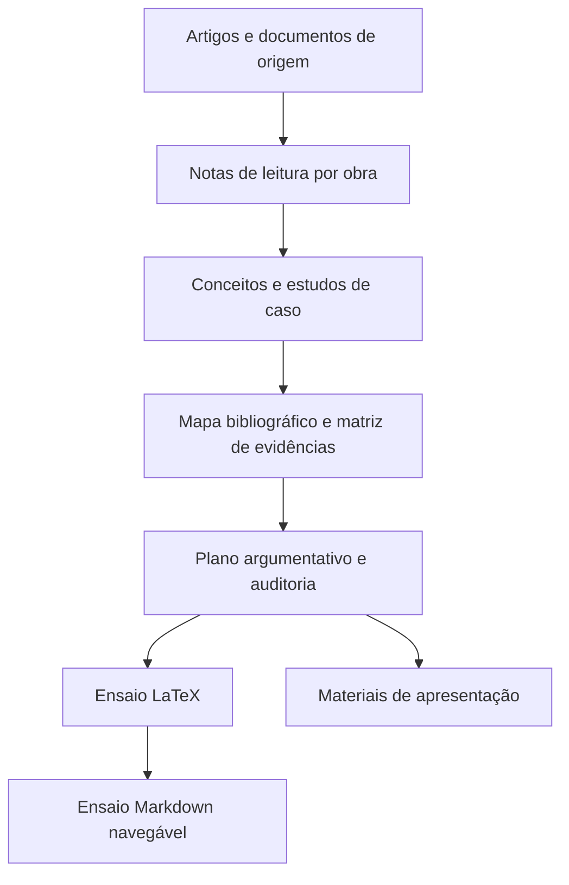

# Arquitetura do projeto

Este repositório é um cofre de pesquisa e produção acadêmica, não uma aplicação de software. Seu fluxo conecta fontes bibliográficas, notas de leitura, síntese de evidências e produtos de escrita/apresentação.

## Componentes

- **Fontes:** PDFs e documentos na raiz e em pastas de leitura. As notas numeradas organizam triagem, extração, conceitos, crítica e contribuição; a presença de uma nota não substitui conferência do original em citações ou controvérsias.
- **Síntese:** `Conceitos/`, `Estudos de caso/`, `Referências/` e `Ensaio/03_Mapa_Bibliografico.md` ligam a literatura às perguntas do ensaio.
- **Rastreabilidade:** `Ensaio/04_Matriz_de_Evidencias.md` registra afirmações e fontes; `Ensaio/07_Referencias_e_Auditoria.md` e `Revisão acadêmica.md` explicitam pendências e problemas de citação.
- **Argumentação:** `Ensaio/05_Plano_Argumentativo.md` orienta a estrutura; `Ensaio/maias.tex` é a fonte de composição declarada pelo mapa; `Ensaio/maias.md` é uma representação navegável.
- **Apresentação:** `Apresentacao/` contém contexto, proposta de slides, roteiro e fontes LaTeX, Markdown e artefatos compilados.
- **Navegação:** `Mapa de Conhecimento.md` é o índice Obsidian do conteúdo temático.

## Fluxo e integridade

A relação pretendida é fonte → nota de leitura → evidência contextualizada → argumento → produto. A auditoria já ressalta que Broda fornece enquadramento mesoamericano amplo, não evidência direta para cada caso maia; Houston e Taube fornecem lente comparativa, não estudo completo de Bonampak. A documentação não altera nem valida por si só afirmações científicas.

## Testes e extensões

Não há suíte automatizada identificada. Extensões naturais do sistema são novas notas de fontes com rastreabilidade, entradas de evidência e revisão do ensaio/apresentação. Mudanças em referências, paginação ou interpretação devem manter alinhadas matriz, auditoria e texto final.
